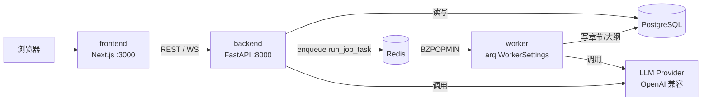
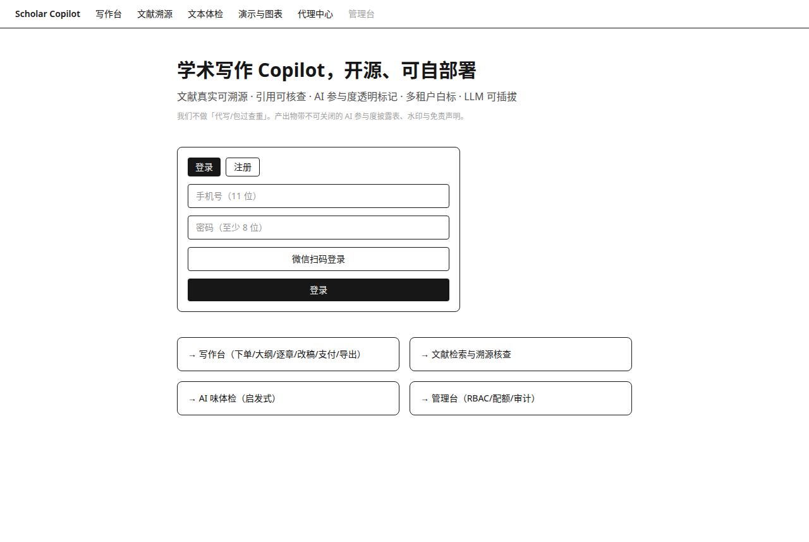
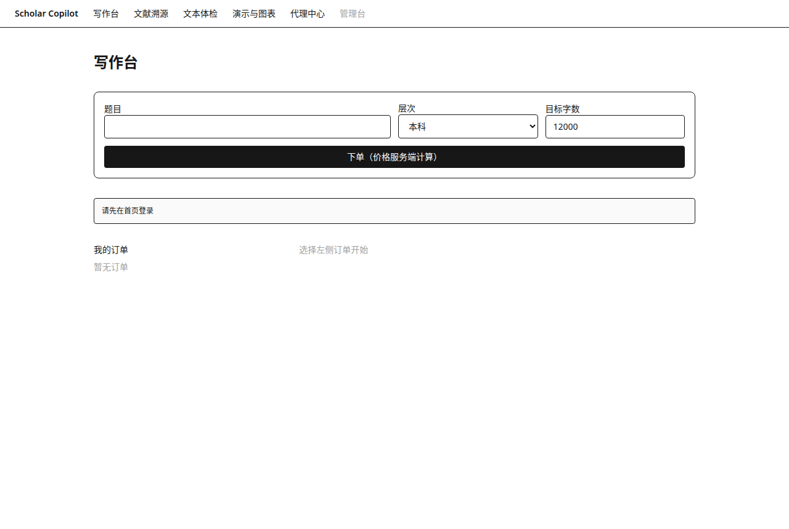
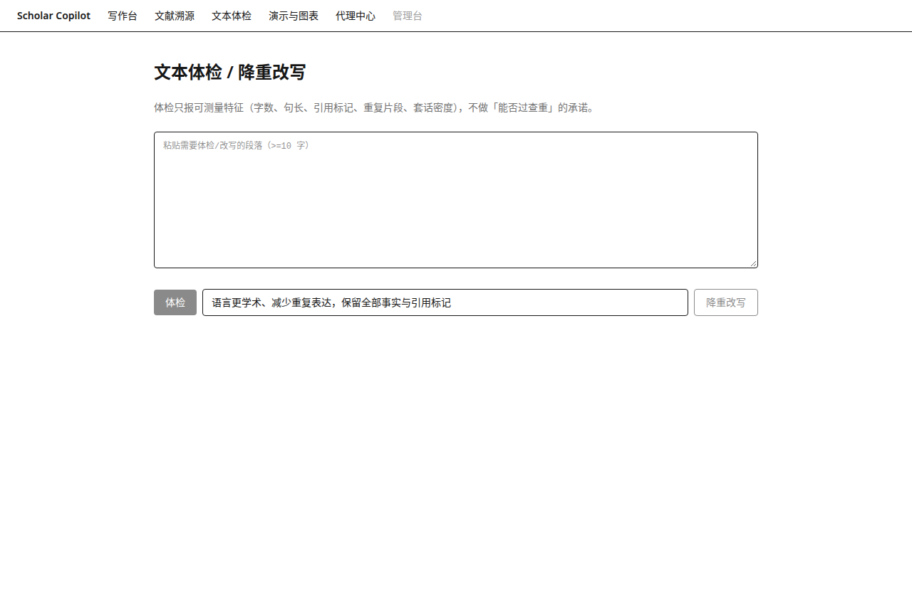
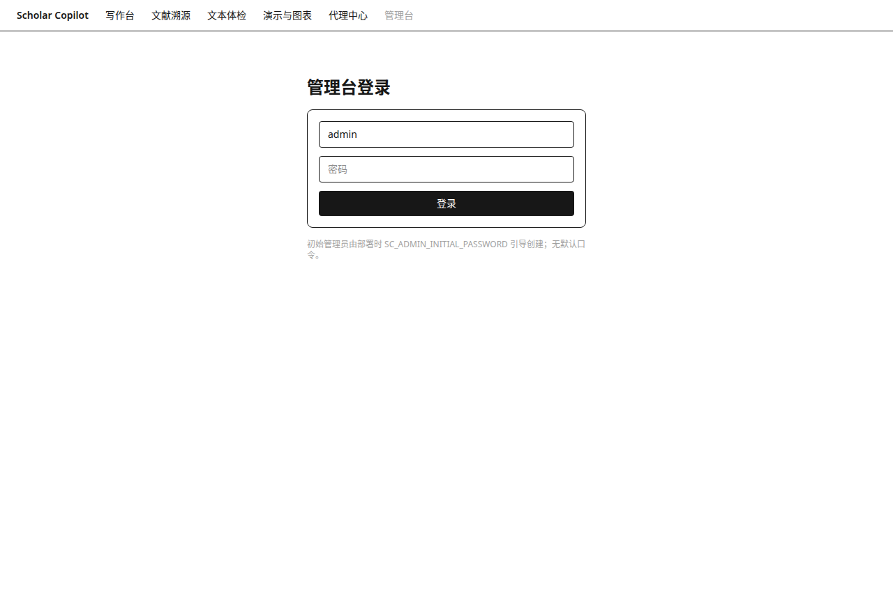

# Scholar Copilot

[](https://github.com/aidless/scholar-copilot/actions/workflows/ci.yml)


**开源的学术写作 Copilot**：文献检索 → 引用溯源 → 大纲/逐章辅助写作 → 引用/数字核查 → 多租户自部署。

> 定位声明：这是一个**写作辅助工具**，不承诺「过查重」、不代写。所有 AI 参与的内容默认携带 A/B/C 三级参与度标记，符合生成式内容标识的合规方向。

## 为什么做这个

市面上同类商业产品（以 blsxueshu.com / okbiye 白标系为代表）是闭源 SaaS。逆向分析发现它的四个系统性问题，本项目从第一行代码起就反向设计：

| 闭源产品的问题（实测） | 本项目的默认设计 |
|---|---|
| 管理台大面积无鉴权，8 租户口令泄露 | 管理台强制 RBAC + 独立会话，见 `docs/THREAT-MODEL.md` |
| 订单接口只验登录不验属主（跨租户 IDOR） | 所有资源查询强制 `tenant_id + owner_id` 双列过滤（数据库层约束） |
| `websiteInfo` 接口明文吐出租户微信/短信密钥 | 密钥只存服务端加密列，任何对外 API 不返回 secret 字段 |
| 短信签名 = sha256(静态盐+手机号)，可离线复算 | 短信签名 = HMAC-SHA256(时间戳+手机号, 服务端密钥)，5 分钟有效 |

另外一个核心差异：**LLM 可插拔**。原产品模型与 prompt 锁死在服务端黑盒里；本项目所有生成走统一的 Provider SPI，接 OpenAI 兼容 API / DeepSeek / Qwen / 本地 vLLM 只改一行配置，prompt 全部开源可审计。

## 架构

```
frontend (Next.js)  ──HTTP──▶  backend (FastAPI)
                                 ├─ tenancy.py      ← 域名/头 → 租户路由 + 属主校验
                                 ├─ routers/        ← auth / writing / references / review / billing / payments / admin / tenant / distributor / tools
                                 ├─ llm/            ← Provider SPI（openai-compat / 本地 vLLM / Ollama）
                                 ├─ tasks/ (arq)    ← 大纲、逐章、核查的异步任务队列
                                 └─ PostgreSQL      ← deploy/init.sql（含租户/属主列约束）
references 模块复用 paperKB (FAISS+SQLite) + paper_agent 证据链
review 模块复用 review-workflow / tmaudit 的核查规则

部署拓扑（`docker compose up` 起的五个容器，生成任务经 Redis 交给独立 worker）：



## 界面预览

真实渲染（`next build` 后 headless Chrome 截图，非设计稿）：

| 登录 / 注册 | 写作台（下单→大纲→逐章→改稿→支付→导出） |
|---|---|
|  |  |
| **文本体检 / 降重改写** | **管理台（RBAC 登录）** |
|  |  |

> 定位上刻意不做「代写 / 过查重」：体检只报可测量特征（字数、句长、引用标记密度、重复片段、套话密度），不承诺检测率。

## 快速开始

**零依赖先看一眼（30 秒，不用 Docker、不用 API 密钥）：**

```bash
bash scripts/demo_local.sh    # SQLite + fake provider，跑完 下单→大纲→逐章→支付→导出
# 产物：/tmp/scholar-copilot-demo/毕业设计.docx（含 AI 披露表 + 免责声明 + 水印）
```

**完整形态：**

```bash
cp .env.example .env          # 填 LLM_API_KEY 等
docker compose up -d          # postgres + redis + backend + worker + frontend
# backend http://localhost:8000/docs   frontend http://localhost:3000
```

本地开发：

```bash
cd backend && pip install -e ".[dev]" && uvicorn app.main:app --reload
cd frontend && npm install && npm run dev
```

想把前端也灌上「一份写好的论文」再演示：

```bash
python scripts/seed_demo.py --base http://localhost:8000   # 账号见脚本内 DEMO_PHONE/DEMO_PASSWORD；订单可直接在 /workbench 打开
```

生产部署（迁移 / TLS / 限流 / 备份）与常见问题：见 [`docs/DEPLOY.md`](docs/DEPLOY.md)。

> **启动自检**：后端启动时会逐条打印「配置看起来能跑、实际跑不通」的警告——
> 缺 LLM 密钥、SMS 开发模式带进生产、mock 支付、默认 JWT 密钥、
> Postgres + create_all 双真相源、memory 限流 + 多进程队列等。只警告不阻断。

## 工程加固（v1.0 → v1.4 持续）

| 项 | 做法 |
|---|---|
| 暴力破解 | 登录/注册按 IP 限流（默认 20 次/分），429 + `Retry-After`；密码统一 401 文案防枚举 |
| LLM 成本滥用 | `/tools/rewrite`、`/tools/detect` 单独限额（默认 10 次/分） |
| 多实例限流失效 | `SC_RATE_LIMIT_BACKEND=redis` 时用 Redis sorted set 共享计数（compose 默认开启）；Redis 不可用降级进程内并打警告，不 500 |
| 前端越权调用 | CORS 白名单（`SC_CORS_ORIGINS`），非白名单来源无 `Access-Control-Allow-Origin` |
| prompt 注入 | 用户文本一律 `wrap_untrusted()` 包裹：边界声明 + 哨兵中和（`<<<`/`>>>`/围栏/哨兵词），有逃逸单测 |
| 数据库演进 | alembic 迁移（`migrations/versions/64bfd6724d4e`），生产 `SC_DB_AUTO_CREATE=false` |
| 交付形态 | 后端/前端 Dockerfile + compose 一键起（postgres/redis/backend/worker/frontend 五容器）；CI 跑 pytest + 空库迁移 + 前端 build |
| schema 漂移 | 单一真相源 = alembic：compose 里 backend 启动先 `alembic upgrade head`，`SC_DB_AUTO_CREATE=false`；`tests/test_migrations_match_models.py` 空库真跑迁移再与 `Base.metadata` 逐表逐列比对（已做删列 RED 反证） |
| 时区崩溃 | 全部时间列 `DateTime(timezone=True)` + 迁移同步；`tests/test_datetime_columns_tz.py` 静态门（Postgres 下 aware/naive 混用会启动即崩，SQLite 测不出） |
| 管理员引导 | 初始 superadmin 引导与建表方式解耦（alembic 建表时也生效），幂等；密码只从环境注入，空则不建 |

## 与已有资产的关系

见 [`docs/PORTING.md`](docs/PORTING.md)——本仓库是多个已有仓库（thesis_auto_generator / paper_agent / paperKB / review-workflow / tmaudit 等）的整合层，不是从零重写。

## 路线图

- [x] v0.1 骨架：monorepo + 建表 + OpenAPI 契约 + SPI 接口
- [x] v0.2 写作流水线（大纲→逐章→改稿→DOCX 导出）：服务端计价、免费大纲 3 次服务端强制（超额 402 + append-only 台账）、AI 参与度 A/B/C 如实标记（生成=A，人工编辑自动升 B，不可关）、导出文档内置披露表 + 免责声明 + 水印；14 项测试 + 真模型端到端冒烟通过
- [x] v0.3 文献检索 + 在线工具：真实查库推荐（OpenAlex 主源 / Crossref 备源 + TTL 缓存，每条带 DOI 可复核，对照闭源产品「百分百真实」口头承诺）、选定文献挂单、粘贴降重改写（LLM）、启发式文本体检（套话/引用密度/重复片段，诚实定性——绝不输出伪精确的「查重率/AIGC 率」）；21 项测试 + 真模型冒烟通过
- [x] v0.4 引用真实性核查 + 格式排版：逐条/批量核查（DOI 直查 + 标题模糊匹配 → verified/suspicious/fake 三态，全带命中证据，不闭环绝不装 verified）；导出支持格式 profile（本科/硕士/博士/英文通用档案，参数透明可查 GET /formatting/profiles）；25 项测试 + 真实 Crossref 核查冒烟通过
- [x] v0.5 支付订单 + 多租户管理端：支付单（服务端价/serial 追踪/mock 网关确认，manual 模式管理员确认，真实商户 webhook 预留 v1.0）；正文生成 402 支付门（大纲免费 3 次）；管理端 JWT RBAC（superadmin/tenant_admin/operator，初始密码仅环境注入、无默认口令）+ 用户/订单/支付/营收统计 + 配额赠送回收（append-only 台账 is_usage 双类行）+ 全动作审计日志；30 项测试 + 真模型支付解锁冒烟通过
- [x] v1.0 工程加固（可一键自部署）：Dockerfile×2 + docker-compose（healthcheck/依赖顺序/env 内联）+ alembic 初始迁移（10 表，空库 upgrade head 通过）+ 三层限流（登录/LLM/检索，429+Retry-After）+ CORS 白名单 + prompt 注入结构化定界（哨兵+中和，含逃逸单测）+ GitHub Actions CI（后端 pytest + alembic 落地 + 前端 typecheck/build）+ 真正可用的 Web UI（登录/写作台/文献/体检/管理台 6 路由）+ `docs/DEPLOY.md`；34 项测试通过、容器内 /health 与注册冒烟通过
- [x] v1.1 白标多租户 + 分销 + 演示与图表：按域名解析租户、`GET /tenant/branding` 只暴露品牌白名单（名称/配色/Logo/客服，绝不返回渠道密钥——正面修复原产品 websiteInfo 泄露洞）；分销代理（推广码登录、佣金=服务端价×万分比、只在订单支付成功时生成、结算/提现全走审计日志）；`POST /tools/ppt` 生成可编辑 PPTX、`POST /tools/diagram` 输出 Mermaid 源码（不返回黑盒图片）；`POST /orders/{id}/export?format=pdf` 真实 LibreOffice 转换；新增 alembic 迁移 e1fecb79f92b（5 表 + writing_orders.distributor_code）；40 项测试通过（含 PDF 真实转换与租户不泄密断言）
- [x] v1.2 认证与任务层：短信验证码改为「随机码 + SHA-256 摘要入库 + 5 分钟过期 + 限 5 次尝试」，且**不对手机号注册状态做分支响应**（正面修复原产品静态盐 sign 的注册状态枚举 oracle）；网关抽象 `dev|http` 两驱动；微信扫码登录（dev 可 mock 确认，生产需 `SC_WECHAT_APP_ID/SECRET`）；任务队列抽象 `SC_TASK_QUEUE=inline|arq`——端点统一 `enqueue()`，切 arq 即交独立 worker（`arq app.tasks.worker.WorkerSettings`），端点契约不变；45 项测试通过
- [x] v1.3 导出与运营报表：LaTeX 导出（`export?format=tex`，ctexart 单文件，特殊字符转义、披露表与免责声明同在）；管理端对账 CSV 导出（订单/支付/佣金/审计四类，UTF-8 BOM、导出动作留审计）；前端补微信扫码入口（dev 模拟确认）与管理台 CSV 按钮；47 项测试通过
- [x] v1.4 检索与可观测性：文献三源降级（OpenAlex → Crossref → Semantic Scholar）+ DOI/标题去重，OpenAlex 支持 `SC_OPENALEX_MAILTO`（礼貌池）/`SC_OPENALEX_API_KEY`，S2 支持 `SC_SEMANTIC_SCHOLAR_API_KEY`；引用核查在 Crossref 未达 verified 时自动补查 S2 并在 `evidence.source` 标注实际源；任务进度 WebSocket `GET /jobs/{id}/ws?token=`（属主校验失败一律 1008 关闭，不泄露任务存在性）；运营日报 `GET /admin/reports/summary?days=`（收入/新单/新用户/任务分布/token 用量），管理台首页展示；59 项测试通过（含迁移-模型一致性门、时区列门、管理员引导门）
- [x] v1.5 运营闭环：限流可切 Redis 共享计数（`SC_RATE_LIMIT_BACKEND`，多实例不再配额放大）；运营日报定时推送 `push_daily_report`（arq cron，口径与管理台 `/admin/reports/summary` 同源，默认关闭，webhook 载荷同时给结构化 `data` 与纯文本 `text`，失败软返回不刷屏）；69 项测试通过（含限流 Redis 后端 4 项与日报推送 6 项）
- [x] v1.6 检索与进度体验：文献源扩到四源（新增 PubMed E-utilities 两步检索 esearch→esummary，可 `SC_PUBMED_ENABLED` 关掉，配 `SC_PUBMED_API_KEY` 从 3 req/s 提到 10 req/s）；写作台任务进度接 WebSocket（`useJobProgress`，WS 建不起来自动降级 2 秒轮询，进度条显示传输方式）；引用核查补查链扩到 Crossref→S2→PubMed（首源达阈值即停，不浪费配额）；`openapi.yaml` 改为从 FastAPI 导出并加一致性门（改了端点没重新导出就红，CI 里也挡）；启动自检把「配置看起来能跑、实际跑不通」前置到启动日志（缺密钥/开发模式/mock 支付/默认 JWT/双真相源/多进程限流）；`scripts/demo_local.sh` 一键演示（30 秒不用 Docker 不用密钥跑完整流程）；worker 健康检查修正（探 HTTP 导致永久 unhealthy 的假警报）；98 项测试通过
- [x] v1.6.1 前端样式修复：`app/layout.tsx` 漏 `import "./globals.css"` 导致 Tailwind 根本没加载（headless 截图暴露：整站渲染成裸 HTML）——补上并重 build 验证 CSS 产物 11,993 字节、登录/写作台/体检/管理台四页截图入库 `docs/screenshots/`，README 加「界面预览」
- [x] v1.7 运营闭环（邮件通道）：日报推送支持 SMTP 邮件第二通道——`SC_REPORT_WEBHOOK_URL` 为空且 `SC_REPORT_EMAIL_TO` 非空时自动走邮件（webhook 优先），支持 STARTTLS/SSL/登录，收件人逗号分隔；发信失败软返回不刷屏；配置齐全时 arq cron 同一份 `summary` 口径双通道复用；107 项测试通过（含邮件通道选择/优先级/软失败/邮件头 5 项 + 真网络假 SMTP 收信实测）
- [x] v1.7 微信真实回调网关：`GET/POST /auth/wechat/callback` 验签（sha1 排序拼接 + `hmac.compare_digest`）+ 事件 XML 解析（subscribe/SCAN → scene 转 scanned/confirmed）+ `POST /auth/wechat/complete` 建号绑定 openid；`users.wechat_openid`/`wechat_scenes.openid` 两列（alembic a7c1e2d4f6b8）；未配 Token/签名错一律 403；14 项测试 + RED→GREEN 反证
- [x] v1.7 导出 LaTeX 编译服务化：`format=latexpdf` → `build_thesis_tex` + `tex_bytes_to_pdf`（xelatex 两遍编译、非交互模式、nonstopmode）；无 TeX → 502 明确报错；CI 装 texlive-xetex/lang-chinese 让真实编译用例执行；测试 5 项（含「未安装 vs 编译失败」强断言 RED→GREEN）

## 学术诚信

本项目的产出物默认携带 AI 参与度标记（A=AI 生成 / B=AI 辅助人写 / C=人写）。v0.2 起，导出的每份 DOCX 必带：每页水印「AI 辅助生成 · 仅供参考」、《AI 参与度披露表》（逐章层级 + 字数）与末页免责声明，均不可关闭；用户人工修改 AI 初稿后层级自动从 A 升为 B，如实披露。请遵守所在机构的学术规范——这是设计立场，不是免责声明。

## License

MIT
